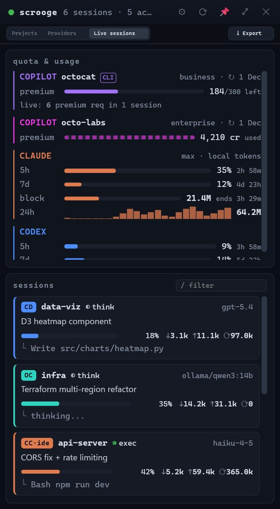
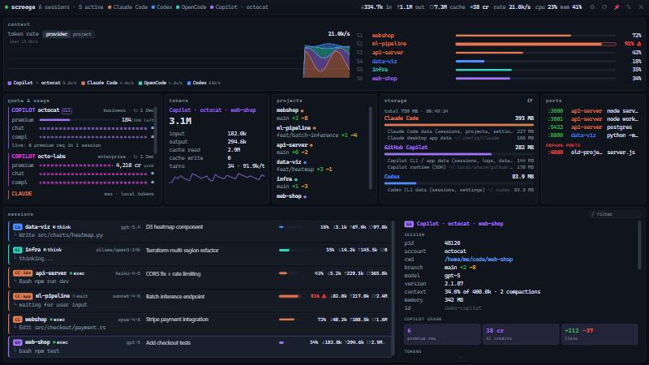

<div align="center">


# Scrooge

**A desktop widget that shows every AI coding agent running on your machine:<br/>sessions, tokens, context windows and quotas, at a glance.**

[](https://github.com/DraconDeSo/scrooge/actions/workflows/ci.yml)
[](https://github.com/DraconDeSo/scrooge/releases/latest)
[](LICENSE)


[Download](https://github.com/DraconDeSo/scrooge/releases/latest) ·
[Documentation](docs/) ·
[Changelog](CHANGELOG.md)


&nbsp;


</div>

## Features

- **All your agents in one place**: Claude Code, Codex CLI, OpenCode, GitHub Copilot
  (CLI and desktop app), Gemini CLI, Antigravity and Grok Build. A provider only appears
  when it runs.
- **Tokens that matter**: read (input), written (output) and cached tokens for every session
  and in total, context-window usage with warning thresholds, recent tools and child
  processes.
- **Quotas and local fallback**: official GitHub Copilot, Claude and Codex limits when
  available; locally observed consumption remains visible without provider CLI
  authentication. Cached Codex limits survive after Codex exits.
- **Two views**: a compact always-on-top panel and a full-screen dashboard with a token-rate
  chart stacked by provider or by project.
- **Disk usage**: how much space each provider takes in every place it stores data
  (sessions, caches, app data, runtimes).
- **Per-provider switches**: disable a provider and Scrooge stops reading its files and
  calling its quota APIs.
- **Tray app**: global shortcut, start at login, remembers position.
- **10 themes × dark/light**: Default, Fallout, Star Wars, Forest, Nordic, Old Paper,
  Cyberpunk, Fantasy, Kawaii, Developer — every palette checked for contrast and for
  distinguishable provider colors.
- **Private by design**: reads local files only; the optional quota calls use tokens taken
  on demand from the official CLIs and never stored.
- **Self-updating** from signed GitHub Releases.

## Install

### Quick install (one-liner)

- **Windows (PowerShell)**:
  ```powershell
  irm https://raw.githubusercontent.com/DraconDeSo/scrooge/main/scripts/install.ps1 | iex
  ```
- **macOS & Linux**:
  ```bash
  curl -fsSL https://raw.githubusercontent.com/DraconDeSo/scrooge/main/scripts/install.sh | sh
  ```

### Package managers

- **Windows (Winget / Scoop)**:
  ```powershell
  winget install DraconDeSo.Scrooge
  # or via Scoop:
  scoop install https://github.com/DraconDeSo/scrooge/releases/latest/download/scrooge.scoop.json
  ```
- **macOS (Homebrew Cask)**:
  ```bash
  brew install --cask https://github.com/DraconDeSo/scrooge/releases/latest/download/scrooge.rb
  ```
- **Arch Linux (AUR / PKGBUILD)**:
  ```bash
  curl -fsSLO https://github.com/DraconDeSo/scrooge/releases/latest/download/PKGBUILD && makepkg -si
  ```
- **Standalone terminal TUI (`abtop`) via Cargo**:
  ```bash
  cargo install --git https://github.com/DraconDeSo/scrooge abtop
  ```

### Direct downloads

Or download the installer or portable archive for your system from the
[latest release](https://github.com/DraconDeSo/scrooge/releases/latest):

| System | Installer | Portable archive |
| --- | --- | --- |
| Windows 10/11 | `Scrooge_<version>_x64-setup.exe` (or `.msi` for managed deployment) | `Scrooge_<version>_x64-portable.zip` |
| macOS (Apple silicon / Intel) | `Scrooge_<version>_aarch64.dmg` / `Scrooge_<version>_x64.dmg` | `Scrooge_<version>_<arch>-portable.tar.gz` |
| Linux | `.deb`, `.rpm` or `.AppImage` | `scrooge_<version>_amd64-portable.tar.gz` |

Details, first-run notes for unsigned builds and the update procedure:
**[docs/installation.md](docs/installation.md)**.

For Copilot quota install the [GitHub CLI](https://cli.github.com/) and log in
(`gh auth login`, once per account). For Claude plan limits log in with the Claude Code CLI.

## Updating

Scrooge checks GitHub Releases at startup and every 6 hours and offers
**Install & restart** when a new version is available (Settings → About → *Check for
updates* to check manually). Packages are signature-verified before installation.
See [Updating](docs/installation.md#updating).

## Documentation

| Guide | |
| --- | --- |
| [User manual](docs/manual.md) | Complete guide to views, quotas, billing and data exports |
| [Installation and updates](docs/installation.md) | Installers, first run, updates, uninstall |
| [Using Scrooge](docs/usage.md) | Views, tray, keyboard shortcuts, exports, statuses |
| [Configuration](docs/configuration.md) | Every setting, config files, environment variables |
| [Providers and data sources](docs/providers.md) | What is read for each agent and how |
| [Troubleshooting](docs/troubleshooting.md) | Common problems |
| [Architecture](docs/architecture.md) | How the app is put together |
| [Development](docs/development.md) | Building from source, tests |
| [Releasing](docs/releasing.md) | Signing keys, release pipeline |

## Build from source

```bash
git clone https://github.com/DraconDeSo/scrooge.git
cd scrooge
npm install
npx tauri dev      # run
npx tauri build    # installers for your OS in target/release/bundle/
```

Prerequisites per OS are listed in [docs/development.md](docs/development.md).

## Contributing

Issues and pull requests are welcome — see [CONTRIBUTING.md](CONTRIBUTING.md). Please report
security issues privately as described in [SECURITY.md](SECURITY.md).

## Acknowledgements

Scrooge is built on [**abtop**](https://github.com/graykode/abtop) by
**Tae Hwan Jung**, the terminal monitor for AI coding agents whose session-discovery engine
powers this app. The engine is included as a modified copy in [`crates/abtop`](crates/abtop)
under its original MIT license; see [NOTICE.md](NOTICE.md) for details. If you prefer a
terminal UI, use abtop directly.

Built with [Tauri](https://tauri.app).

## License

[MIT](LICENSE). Product names are trademarks of their respective owners; Scrooge is not
affiliated with any of them.
