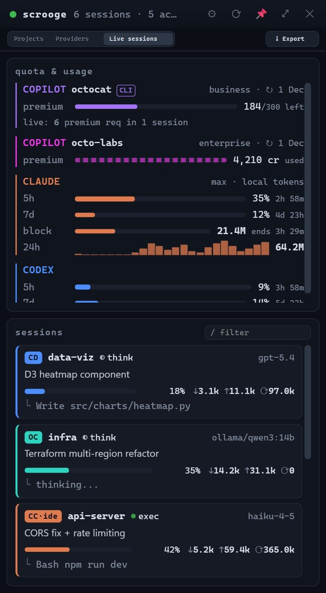
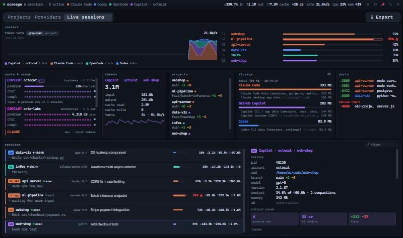
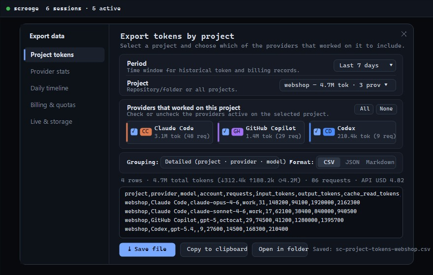

# Scrooge User Manual

**Scrooge** is an ultra-lightweight desktop monitor for developers that displays real-time and historical activity across every AI coding agent running on your machine: **Claude Code**, **Codex CLI**, **OpenCode**, **GitHub Copilot** (CLI and Desktop), **Gemini CLI / Antigravity**, and **Grok Build**.

  
  &nbsp;
  

---

## Table of Contents

1. [Overview & Design Principles (Privacy & Efficiency)](#1-overview--design-principles-privacy--efficiency)
2. [Window Modes](#2-window-modes)
   - [Compact Panel (`Compact`)](#compact-panel-compact)
   - [Full-Screen Dashboard (`Full screen`)](#full-screen-dashboard-full-screen)
3. [Dashboard Views: `Live sessions`, `Projects`, `Providers`](#3-dashboard-views-live-sessions-projects-providers)
   - [`Live sessions`](#31-live-sessions)
   - [`Projects` (Historical usage by project)](#32-projects-historical-usage-by-project)
   - [`Providers` (Historical usage & live quotas by provider)](#33-providers-historical-usage--live-quotas-by-provider)
4. [Data Export (`CSV`, `JSON`, `Markdown`)](#4-data-export-csv-json-markdown)
   - [1. Project tokens (filtered by active providers on that project)](#preset-1-project-tokens--tokens-used-per-project)
   - [2. Provider stats (usage statistics by provider & period)](#preset-2-provider-stats--usage-statistics-by-provider--period)
   - [3. Daily timeline (day-by-day historical breakdown)](#preset-3-daily-timeline--day-by-day-history)
   - [4. Billing & quotas (recorded charges & live quotas)](#preset-4-billing--quotas--recorded-charges--live-quotas)
   - [5. Live & storage (running sessions & disk usage snapshot)](#preset-5-live--storage--running-sessions--disk-usage)
5. [Quotas, Plan Limits & Billing](#5-quotas-plan-limits--billing)
6. [System Tray, Keyboard Shortcuts & Window Controls](#6-system-tray-keyboard-shortcuts--window-controls)
7. [Settings & Customization (Themes & Provider Colors)](#7-settings--customization-themes--provider-colors)

---

## 1. Overview & Design Principles (Privacy & Efficiency)

- **100% local session inspection**: Scrooge reads the session transcripts and state files already written locally by your coding agents (`~/.claude`, `~/.codex`, `~/.copilot`, `~/.gemini`, OpenCode's SQLite database, etc.).
- **No chat prompts stored in historical usage**: when computing historical usage (`Projects` and `Providers`), Scrooge extracts only timestamps, project paths, model names, token counts (`input`, `output`, `cache_read`, `cache_write`), and billing amounts—discarding prompt and reply text.
- **No stored credentials**: optional live quota checks (GitHub Copilot and Claude Code) read tokens on demand from the official CLIs (`gh auth token` and Claude Code's login) and never store them on disk.
- **Ultra-lightweight background footprint**: when hidden in the system tray, Scrooge pauses WebView IPC emissions, skips DOM rendering, and throttles background polling to keep CPU and RAM overhead near zero.

---

## 2. Window Modes

Switch between **Compact** and **Full screen** at any time by pressing **`F`**, clicking `⤢` / `⤡` in the title bar, or using the system tray menu.

### Compact Panel (`Compact`)
A frameless floating panel (400×600 px by default), kept above other windows (*Always on top* toggleable via `📌`):
- **Dragging & Edge Snapping**: drag the panel by its title bar; on Windows it snaps cleanly to screen edges without triggering Windows Aero resize.
- **Top-edge Full-Screen Drop**: drag and release the compact panel against the top edge of any monitor to expand it into **Full screen** mode on that monitor.
- **Layout**: displays the view switcher (`Projects | Providers | Live sessions` + `⤓ Export`), the **quota & usage** summary strip, and the list of active **sessions** (click any card to expand its details).

### Full-Screen Dashboard (`Full screen`)
A `btop`-inspired dashboard covering the current monitor with 7 panels:
1. **`context`**: real-time **token rate** (`tok/s`) chart stacked **by provider** or **by project** (click legend items to show/hide series) alongside context-window usage bars for every active session (`S1`, `S2`, …).
2. **`quota & usage`**: quota bars for every GitHub Copilot account, Claude 5h/7d plan limits (plus local 5-hour block, 24h hourly histogram, and 7-day token totals), and Codex rate limits.
3. **`tokens`**: aggregate or selected-session token counters (`input`, `output`, `cache read`, `cache write`, turns, and average tokens/turn) with a provider split bar and turn sparkline.
4. **`projects`**: active Git repositories showing the current branch, added/deleted line counts (`+added -deleted`), and colored provider dots indicating which agents are working in each project.
5. **`storage`**: disk space used by each provider across sessions, caches, desktop app data, and bundled runtimes. Click any path to reveal it in File Explorer / Finder.
6. **`ports`**: listening TCP ports opened by agent child processes (e.g., dev servers on `:3000`, `:8000`) plus **orphan ports** left behind by ended sessions.
7. **`sessions` + `detail`**: session table on the left and a comprehensive inspector pane on the right (PID, clickable working directory, branch, model, CLI version, context %, process memory, Copilot usage boxes, recent tool calls, child processes, and latest chat turns).

---

## 3. Dashboard Views: `Live sessions`, `Projects`, `Providers`

Use the top toolbar to switch between three views in both Compact and Full-screen modes:

### 3.1 `Live sessions`
Shows all coding agents currently running or waiting for input on your machine:
- Each session card carries its provider badge and color (`CC` Claude Code CLI, `CC·app` Claude Desktop, `CC·ide` Claude IDE, `CD` Codex, `OC` OpenCode, `GH` Copilot CLI, `GH·app` Copilot Desktop, `GM` Gemini CLI, `GK` Grok).
- **Status indicators**:
  - `● exec` (blinking green): a tool call is currently executing.
  - `◐ think`: the model is generating a response.
  - `○ wait`: idle, waiting for user input.
  - `⏳ rate`: waiting on a provider rate limit.
  - `? unknown`: recent session whose OS process could not be confirmed.
- **Quick filter (`/`)**: press `/` to filter sessions by project name, model, provider, branch, or current task.

### 3.2 `Projects` (Historical usage by project)
Groups historical token consumption and billing charges by **local project** (automatically unifying linked Git worktrees under their main repository checkout):
- **Period selector**: choose `Today`, `Last 7 days`, `Last 30 days`, or `Custom dates` (`From … Through …` in your local time zone).
- Expand any project row (`▸`) to inspect usage broken down by **provider, model, and account**, including:
  - Total tokens and `↓ input`, `↑ output`, `⟳ cache` (`cache_read + cache_write`) split.
  - Recorded or synced billing charges (`API` and `Plan extra`).
- Click the **`⤓`** button on any project row to open the Export dialog pre-selected on that project.

### 3.3 `Providers` (Historical usage & live quotas by provider)
Groups historical token usage and costs by **provider** (`Claude Code`, `Codex`, `GitHub Copilot`, `Google / Gemini`, `OpenCode`, `Grok Build`) for the chosen period, while also displaying each provider's current **live quota** and reset countdown.

---

## 4. Data Export (`CSV`, `JSON`, `Markdown`)

  

Open the **Export data** dialog in any of three ways:
1. Click **`⤓ Export`** in the top toolbar.
2. Press **`E`** on your keyboard.
3. Click the **`⤓`** icon on any project row (in `Projects`) or provider row (in `Providers`) to open the dialog pre-filtered for that item.

The export dialog provides **5 specialized presets**:

### Preset 1: `Project tokens` — Tokens used per project
Designed for project-level token accounting and reporting:
1. **Period**: select `Today`, `Last 7 days`, `Last 30 days`, `Last 90 days`, `Last 365 days`, or `Custom dates`.
2. **Project**: pick a specific project from the dropdown (sorted by total token usage) or `All projects`.
3. **Providers that worked on this project**:
   - Lists **only the providers that actually have recorded activity on the selected project(s)** during the chosen period, along with their token and request counts on that project.
   - Check or uncheck individual providers (or use `All` / `None`) to include only the providers you want in the export.
4. **Grouping**:
   - `Detailed (project · provider · model · account)`: one row per project, provider, model, and account.
   - `By project & provider`: aggregated per project and provider.
   - `Summary totals`: one summary row per project listing the included providers.

### Preset 2: `Provider stats` — Usage statistics by provider & period
Designed for analyzing or exporting usage across providers over any date range:
1. **Period**: select a preset window or custom `From` / `Through` dates.
2. **Providers to include**: check one, several, or all enabled providers.
3. **Grouping**: detailed by model/project, grouped by project & provider, or a high-level summary per provider.

### Preset 3: `Daily timeline` — Day-by-day history
Exports a chronological **day-by-day (`YYYY-MM-DD`)** breakdown of requests, `input`, `output`, `cache_read`, `cache_write`, `total_tokens`, and charges—filterable simultaneously by **Period**, **Project**, and **Providers**. Ideal for time-series charts in Excel, Google Sheets, or BI tools.

### Preset 4: `Billing & quotas` — Recorded charges & live quotas
Combines in a single export:
- All recorded or synced billing charges (`API` and `Plan extra`) in the selected period by provider, account, project, and model.
- Current live quota snapshots (GitHub Copilot accounts, bucket remaining percentages, plans and reset dates, plus Claude and Codex 5h/7d rate limits).

### Preset 5: `Live & storage` — Running sessions & disk usage
Captures a point-in-time snapshot of all currently active/idle sessions (provider, status, project, branch, model, context window %, token counts, Copilot credits, PID, listening ports) together with disk space used per provider.

### Output Formats, Preview & Saving
- **Formats**:
  - **`CSV`**: RFC-4180 compliant, ready for Excel, Google Sheets, or LibreOffice Calc.
  - **`JSON`**: structured object containing metadata (`exported_at`, `preset`, `period`, `project_filter`, `providers_included`), `summary` totals, and `rows`.
  - **`Markdown`**: formatted document with header metadata, summary metrics, and a GitHub-Flavored Markdown table ready to paste into PRs, Notion, Confluence, or client reports.
- **Live Preview**: inspect the matching row count, total tokens (`↓ in`, `↑ out`, `⟳ cache`), and generated text before saving.
- **`⤓ Save file` & `Copy to clipboard`**:
  - **Save file** writes the file directly to your `Downloads` folder (e.g., `scrooge-project-tokens-webshop-last_7d.csv`) and reveals an **Open in folder** button to highlight the file in File Explorer / Finder.
  - **Copy to clipboard** copies the generated output with one click.

---

## 5. Quotas, Plan Limits & Billing

- **GitHub Copilot**: install the [GitHub CLI (`gh`)](https://cli.github.com/) and run `gh auth login`. Scrooge detects every account logged into `gh auth status` plus the Copilot CLI login, assigning each account its own color and tracking its buckets (`premium_interactions`, `chat`, `completions`) and AI credits (in credits or USD).
- **Claude Code**:
  - **Plan limits (5h / 7d %)**: requires logging in once via the Claude Code CLI (`claude` → `/login`).
  - **Local token consumption**: works automatically without login by scanning transcripts in `~/.claude/projects`.
- **Manual Billing Imports & Automatic Cloud Sync**:
  - In `Projects` or `Providers` → `Data sources` → **Open usage imports folder**, open the `imports` folder (`%APPDATA%\scrooge\imports` on Windows).
  - Drop `.jsonl` files for manual billing records or configure `billing-sources.json` to automatically sync spend from **OpenAI**, **Anthropic**, **GitHub Copilot**, **xAI (Grok)**, and **Google Cloud BigQuery** (see [docs/usage.md](usage.md#automatic-billing)).

---

## 6. System Tray, Keyboard Shortcuts & Window Controls

- **Left-click tray icon**: show or hide the Scrooge window.
- **Right-click tray icon**: open the tray menu (*Show / hide*, *Compact panel*, *Full screen*, *Always on top*, *Refresh now*, *Settings…*, *Quit*).
- **Close button (`✕`)**: hides the window to the system tray so background monitoring continues; use *Quit* from the tray menu or *Settings → About → Quit Scrooge* to exit completely.

### Keyboard Shortcuts

| Key | Action |
| :--- | :--- |
| `Ctrl+Alt+A` | Show / hide Scrooge from anywhere (configurable in *Settings → General*) |
| `F` | Toggle between **Compact panel** and **Full screen** |
| `E` | Open the **Export data** dialog |
| `S` | Open **Settings** |
| `R` | Refresh sessions, quotas, and usage history immediately |
| `/` | Focus the live session filter input |
| `↑` / `↓` (or `j` / `k`) | Select the previous / next session |
| `Enter` | Expand / collapse the selected session card (in Compact mode) |
| `Esc` | Close the open dialog (`Export` / `Settings`), return to Compact from Full screen, or hide to tray |

---

## 7. Settings & Customization (Themes & Provider Colors)

Open **Settings (`⚙` or `S`)** to configure 6 sections:
1. **General**: start at login, stay hidden in the tray at login, startup view (`Compact` or `Full screen`), *Always on top*, global shortcut recorder, and polling intervals (*Session refresh* 1–10 s, *Quota refresh* 1–60 min).
2. **Appearance**:
   - **10 Themes** (*Default*, *Fallout*, *Star Wars*, *Forest*, *Nordic*, *Old Paper*, *Cyberpunk*, *Fantasy*, *Kawaii*, *Developer*), each with **Dark**, **Light**, or **System** mode.
   - **Density**: *Small*, *Normal*, or *Large*.
   - **Provider colors**: customize the color of any provider or Copilot account (Scrooge automatically prevents picking two colors that are too visually similar).
   - **Warning & Critical thresholds**: percentages at which context and quota indicators turn yellow or red (`⚠`).
3. **Providers**: enable or disable individual providers. Disabled providers are completely skipped during disk scans and network quota checks.
4. **Sessions**: initial session sort order (*Most recent*, *Activity*, *Provider*, *Context usage*, *Tokens*) and toggles for idle sessions, chat history in details, and the current task line.
5. **Quota & accounts**: toggle visibility for individual GitHub Copilot accounts, switch AI credits between `Credits` and `USD estimate` (with configurable USD rate per credit), and inspect Claude data source status.
6. **About**: current version, signed GitHub Release update checker, quick **Open** buttons for configuration/data folders, keyboard reference, and **Quit Scrooge**.
